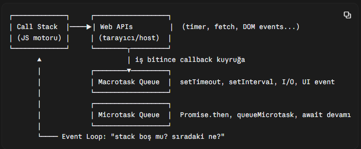
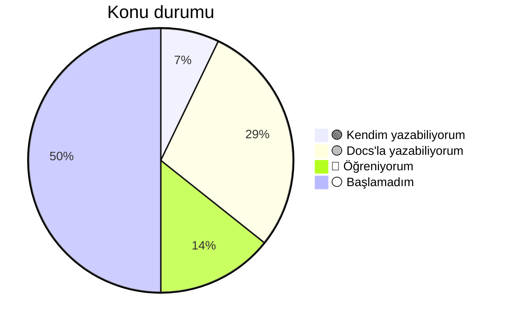

# 📚 TIL – Today I Learned

JavaScript ve React yolculuğumda öğrendiklerimi, takıldığım yerleri ve ilerlememi tuttuğum yer.

**Kural:** Bir konuyu ancak AI'a ya da docs'a bakmadan kendim yazabildiğimde 🟢 yaparım.

**Son güncelleme:** 3 Kasım 2026 · TIL Day 1

---

## 📈 Aktivite

## 🆕 Son öğrendiğim: JS Event Loop

> [js/eventLoop.md](js/eventLoop.md)

- JavaScript **tek thread** üzerinde çalışır ve tek bir **call stack**'i vardır; aynı anda yalnızca bir fonksiyon yürütülür.
- `setTimeout`, ağ isteği, kullanıcı event'i gibi işleri JS motoru değil **host ortam** (tarayıcı / Node) yürütür; iş bitince callback'leri kuyruğa koyar.
- Event loop her turda **bir macrotask** çalıştırır (ilk tur script'in kendisi), ardından **microtask kuyruğunu tamamen** boşaltır, sonra render'a fırsat verir.
- `Promise.then`, `queueMicrotask` ve `await` sonrası kod microtask; `setTimeout` macrotask olduğu için Promise callback'i her zaman `setTimeout(fn, 0)`'dan önce çalışır.
- Promise executor'ı ve `async` fonksiyonun ilk `await`'e kadarki kısmı **senkron** çalışır.
- Sonsuz microtask zinciri render'ı engeller (**microtask starvation**); ağır işi parçalayıp macrotask ile yield etmek gerekir.

## 🎯 Genel ilerleme

| Alan       | İlerleme   | Başlanan konu |
| ---------- | ---------- | :-----------: |
| JavaScript | `███░░░░░░░` |     2 / 7     |
| React      | `█████░░░░░` |     4 / 7     |

_İlerleme, ⚪ dışındaki (başladığım) konu sayısını gösterir._

---

## 🗂️ Konular

**Durumlar:** ⚪ Başlamadım · 🔴 Öğreniyorum · 🟡 Docs'a bakarak yazabiliyorum · 🟢 Kendim yazabiliyorum

### JavaScript

| Konu                     | Durum | Not                                |
| ------------------------ | :---: | ---------------------------------- |
| map / filter             |  🟢   | –                                  |
| JS Event Loop            |  🟡   | [js/eventLoop.md](js/eventLoop.md) |
| reduce                   |  🔴   | [js/reduce.md](js/reduce.md)       |
| destructuring & spread   |   ⚪   | –                                  |
| async / await & fetch    |   ⚪   | –                                  |
| closure                  |   ⚪   | –                                  |
| array & object metodları |   ⚪   | –                                  |

### React

| Konu                 | Durum | Not |
| -------------------- | :---: | --- |
| useState & useEffect |  🟡   | –   |
| useMemo              |  🟡   | –   |
| React.memo           |  🟡   | –   |
| custom hook          |  🔴   | –   |
| useContext           |   ⚪   | –   |
| useReducer           |   ⚪   | –   |
| useCallback          |   ⚪   | –   |

---

## 📓 Günlük

- [Kasım 2026](gunluk/2026-11.md)
- **3 Kasım 2026 · TIL Day 1:** JS Event Loop ve event lifecycle – [not](js/eventLoop.md)

---

## 🔁 Seans sonu rutini

1. Öğrendiğimi ilgili notuna yaz (kendi örneğimle)
2. Günlüğe 3 satır: **Yaptım / Takıldım / Sonraki adım**
3. Durumu değişen konu varsa tabloyu ve grafiği güncelle
4. `git add . && git commit -m "..." && git push`
