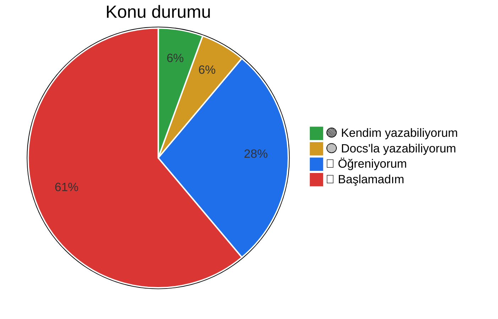

# 📚 TIL – Today I Learned

JavaScript, React ve web güvenliği yolculuğumda öğrendiklerimi, takıldığım yerleri ve ilerlememi tuttuğum yer.

**Kural:** Bir konuyu ancak AI'a ya da docs'a bakmadan kendim yazabildiğimde 🟢 yaparım.

**Son güncelleme:** 5 Kasım 2026 · TIL Day 3

---

## 📈 GitHub istatistikleri

  

  
  

Kartlar <a href="https://github.com/vn7n24fzkq/github-profile-summary-cards">github-profile-summary-cards</a> tarafından üretiliyor.

## 🆕 Son öğrendiğim: Web güvenliği temelleri

> [web-security/README.md](web-security/README.md)

- **SQL Injection'a karşı birincil önlem parametreli sorgular.** Kullanıcı girdisi sorgu metnine string birleştirmeyle değil, ayrı parametre olarak verilir; böylece veri hiçbir zaman SQL kodu olarak yorumlanmaz.
- **Şifreler DB'de bilerek yavaş hash'lenen bir algoritmayla saklanır.** MD5/SHA gibi hızlı hash'ler değil; maliyeti ayarlanabilir bcrypt, scrypt veya Argon2 + benzersiz salt kullanılır.
- **CORS bir izin mekanizmasıdır, koruma değildir.** Tarayıcının başka origin'den gelen cevabı okuyup okuyamayacağını belirler; API'yi saldırılardan korumaz (auth, CSRF ve rate limiting ayrıca gerekir).
- **Origin = scheme + host + port.** `https://example.com` ile `https://example.com:8443` farklı origin'dir; port yazılmasa da varsayılan port hesaba katılır (HTTPS **443**, HTTP **80**).

## 🎯 Genel ilerleme

<!-- PROGRESS:START -->

| Klasör | Tamamlanan | Toplam | Oran | İlerleme |
| --- | :---: | :---: | :---: | --- |
| [JavaScript](javascript/README.md) | 2 | 77 | 3% | `░░░░░░░░░░` |
| [React](react/README.md) | 3 | 61 | 5% | `█░░░░░░░░░` |
| [Web Güvenliği](web-security/README.md) | 4 | 72 | 6% | `█░░░░░░░░░` |
| **Toplam** | **9** | **210** | **4%** | `░░░░░░░░░░` |

<b>JavaScript</b>: aşamalara göre

| Aşama | Tamamlanan | Toplam | Oran | İlerleme |
| --- | :---: | :---: | :---: | --- |
| 1. JavaScript Fundamentals | 0 | 10 | 0% | `░░░░░░░░░░` |
| 2. Advanced JavaScript | 0 | 12 | 0% | `░░░░░░░░░░` |
| 3. Asynchronous JavaScript | 1 | 12 | 8% | `█░░░░░░░░░` |
| 4. Modern JavaScript (ES6+) | 1 | 11 | 9% | `█░░░░░░░░░` |
| 5. Browser JavaScript | 0 | 12 | 0% | `░░░░░░░░░░` |
| 6. JavaScript Performance | 0 | 9 | 0% | `░░░░░░░░░░` |
| 7. JavaScript Internals ve İleri Konular | 0 | 11 | 0% | `░░░░░░░░░░` |

<b>React</b>: aşamalara göre

| Aşama | Tamamlanan | Toplam | Oran | İlerleme |
| --- | :---: | :---: | :---: | --- |
| 1. React temellerini tamamla | 3 | 9 | 33% | `███░░░░░░░` |
| 2. İleri React | 0 | 9 | 0% | `░░░░░░░░░░` |
| 3. TypeScript | 0 | 8 | 0% | `░░░░░░░░░░` |
| 4. Modern frontend ekosistemi | 0 | 8 | 0% | `░░░░░░░░░░` |
| 5. Next.js | 0 | 12 | 0% | `░░░░░░░░░░` |
| 6. Testing ve kalite | 0 | 7 | 0% | `░░░░░░░░░░` |
| 7. Production seviyesinde geliştirme | 0 | 8 | 0% | `░░░░░░░░░░` |

<b>Web Güvenliği</b>: aşamalara göre

| Aşama | Tamamlanan | Toplam | Oran | İlerleme |
| --- | :---: | :---: | :---: | --- |
| 1. Web Security Fundamentals | 2 | 9 | 22% | `██░░░░░░░░` |
| 2. Client-Side Security | 0 | 11 | 0% | `░░░░░░░░░░` |
| 3. Authentication & Authorization Security | 1 | 10 | 10% | `█░░░░░░░░░` |
| 4. API & Backend Security | 1 | 11 | 9% | `█░░░░░░░░░` |
| 5. Modern Web Application Security | 0 | 10 | 0% | `░░░░░░░░░░` |
| 6. Security Testing & Pentesting | 0 | 11 | 0% | `░░░░░░░░░░` |
| 7. Advanced Security | 0 | 10 | 0% | `░░░░░░░░░░` |

_Bu tablo `scripts/update-progress.mjs` ile üretilir, elle düzenlemeyin. Kurallar için [CONTRIBUTING.md](CONTRIBUTING.md)._

<!-- PROGRESS:END -->

**Konu durumu** (🔴🔵🟡🟢 etiketleri, aşağıdaki Konular tablosundan elle güncellenir):

---

## 🗂️ Konular

**Durumlar:** 🔴 Başlamadım · 🔵 Öğreniyorum · 🟡 Docs'a bakarak yazabiliyorum · 🟢 Kendim yazabiliyorum

### JavaScript

| Konu                     | Durum | Not                                |
| ------------------------ | :---: | ---------------------------------- |
| map / filter             |  🟢   | –                                  |
| JS Event Loop            |  🟡   | [javascript/3-asenkron-javascript/event-loop.md](javascript/3-asenkron-javascript/event-loop.md) |
| reduce                   |  🔵   | [javascript/4-modern-javascript-es6/array-methods.md](javascript/4-modern-javascript-es6/array-methods.md)       |
| destructuring & spread   |   🔴   | –                                  |
| async / await & fetch    |   🔴   | –                                  |
| closure                  |   🔴   | –                                  |
| array & object metodları |   🔴   | –                                  |

> Detaylı yol haritası ve konu şablonları: [javascript/README.md](javascript/README.md)

### React

> Detaylı yol haritası ve konu şablonları: [react/README.md](react/README.md)

| Konu                 | Durum | Not |
| -------------------- | :---: | --- |
| useState & useEffect |  🔴   | –   |
| useMemo              |  🔴   | –   |
| React.memo           |  🔴   | –   |
| custom hook          |  🔴   | –   |
| useContext           |   🔴   | –   |
| useReducer           |   🔴   | –   |
| useCallback          |   🔴   | –   |

### Web & Güvenlik

| Konu                        | Durum | Not                                               |
| --------------------------- | :---: | ------------------------------------------------- |
| SQL Injection               |  🔵   | [web-security/4-api-backend-guvenlik/sql-injection.md](web-security/4-api-backend-guvenlik/sql-injection.md) |
| Şifre saklama & hash'leme   |  🔵   | [web-security/3-auth-guvenlik/password-hashing.md](web-security/3-auth-guvenlik/password-hashing.md) |
| CORS                        |  🔵   | [web-security/1-web-guvenligi-temelleri/cors.md](web-security/1-web-guvenligi-temelleri/cors.md) |
| Origin & portlar            |  🔵   | [web-security/1-web-guvenligi-temelleri/same-origin-policy.md](web-security/1-web-guvenligi-temelleri/same-origin-policy.md) |

> Detaylı yol haritası ve konu şablonları: [web-security/README.md](web-security/README.md)

---

## 📚 Öğrenilen Kaynaklar

> Kitap, doküman, video ve kurs listeleri: [kaynaklar/README.md](kaynaklar/README.md)

- [React](kaynaklar/react.md) · [JavaScript](kaynaklar/javascript.md) · [Web Güvenliği](kaynaklar/web-security.md)

---

## 📓 Günlük

- [Kasım 2026](gunluk/2026-11.md)
- **3 Kasım 2026 · TIL Day 1:** JS Event Loop ve event lifecycle – [not](javascript/3-asenkron-javascript/event-loop.md)
- **4 Kasım 2026 · TIL Day 2:** Array metodları (map / filter / reduce / find / some / every / forEach) – [not](javascript/4-modern-javascript-es6/array-methods.md)
- **5 Kasım 2026 · TIL Day 3:** Web güvenliği (SQL Injection, şifre hash'leme, CORS, Origin) – [not](web-security/README.md)

---

## 🔁 Seans sonu rutini

1. Öğrendiğimi ilgili notuna yaz (kendi örneğimle)
2. Günlüğe 3 satır: **Yaptım / Takıldım / Sonraki adım**
3. Durumu değişen konu varsa tabloyu ve grafiği güncelle
4. `git add . && git commit -m "..." && git push`
