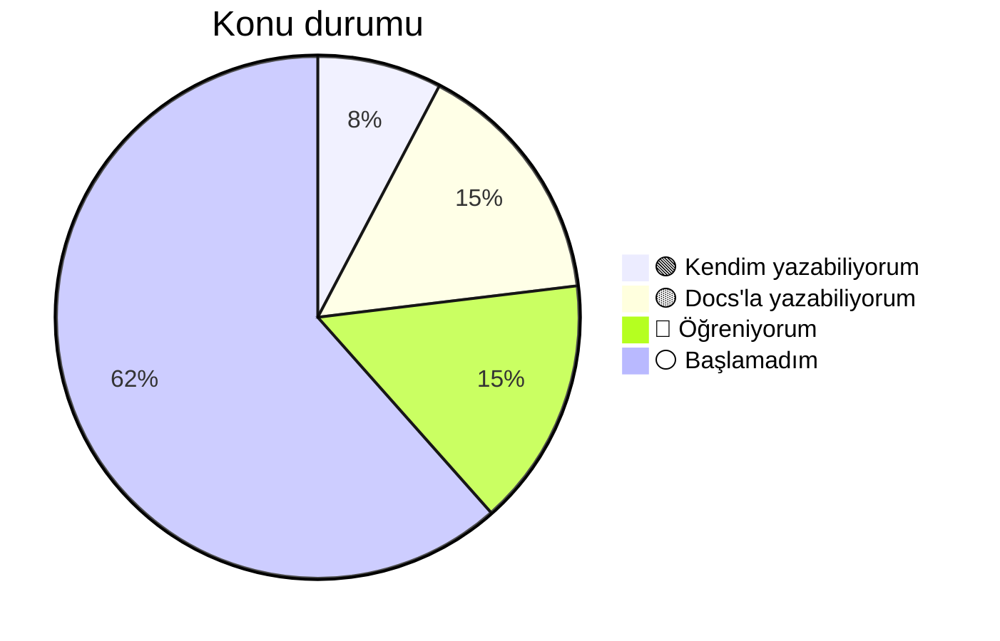

# 📚 TIL – Today I Learned

JavaScript ve React yolculuğumda öğrendiklerimi, takıldığım yerleri ve ilerlememi tuttuğum yer.

**Kural:** Bir konuyu ancak AI'a ya da docs'a bakmadan kendim yazabildiğimde 🟢 yaparım.

---

## 📈 Aktivite

## 🎯 Genel ilerleme

| Alan | İlerleme |
|------|----------|
| JavaScript | `██░░░░░░░░` 1 / 6 |
| React | `███░░░░░░░` 2 / 7 |

---

## 🗂️ Konular

**Durumlar:** ⚪ Başlamadım · 🔴 Öğreniyorum · 🟡 Docs'a bakarak yazabiliyorum · 🟢 Kendim yazabiliyorum

### JavaScript

| Konu | Durum | Not |
|------|:-----:|-----|
| map / filter | 🟢 | – |
| reduce | 🔴 | [js/reduce.md](js/reduce.md) |
| destructuring & spread | ⚪ | – |
| async / await & fetch | ⚪ | – |
| closure | ⚪ | – |
| array & object metodları | ⚪ | – |

### React

| Konu | Durum | Not |
|------|:-----:|-----|
| useState & useEffect | 🟡 | – |
| useMemo | 🟡 | [react/useMemo.md](react/useMemo.md) |
| React.memo | 🟡 | [react/react-memo.md](react/react-memo.md) |
| custom hook | 🔴 | [react/custom-hook.md](react/custom-hook.md) |
| useContext | ⚪ | – |
| useReducer | ⚪ | – |
| useCallback | ⚪ | – |

---

## 📓 Günlük

- [Kasım 2026](gunluk/2026-11.md)

---

## 🔁 Seans sonu rutini

1. Öğrendiğimi ilgili notuna yaz (kendi örneğimle)
2. Günlüğe 3 satır: **Yaptım / Takıldım / Sonraki adım**
3. Durumu değişen konu varsa tabloyu ve grafiği güncelle
4. `git add . && git commit -m "..." && git push`
